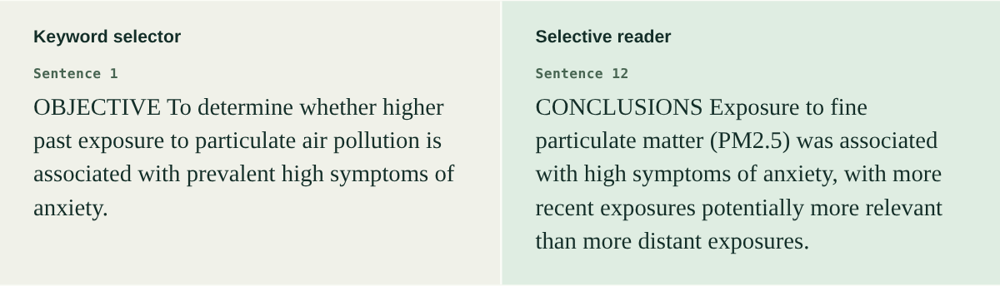

# SciFact Evidence Reader

Given a scientific claim, this tool searches 5,183 research abstracts for a sentence that helps a reader assess it. If the best sentence falls below a cutoff learned on training data, the reader can abstain.

**[Open the browser demo](https://nikosmav.github.io/scifact-hybrid-retrieval/)** · Three recorded searches with the original abstracts and expert annotations. To search for your own claim, use the [local reader](#search-for-your-own-claim).

## Start with the air-pollution claim

Is exposure to fine particulate air pollution associated with anxiety symptoms? A keyword search finds the right paper, but its top sentence describes what the researchers *wanted to find out*. The selective reader shows sentence 12, where they report the association they observed. Open **Check the expert annotation** to see which sentences the dataset accepts as evidence.

[](https://nikosmav.github.io/scifact-hybrid-retrieval/#case-399)

Two more examples show when the choice is harder. In the [open-access citations case](https://nikosmav.github.io/scifact-hybrid-retrieval/#case-129), the reader withholds a sentence about authors’ earlier citation records. In the [vision-screening case](https://nikosmav.github.io/scifact-hybrid-retrieval/#case-137), the experts require two sentences from the same abstract.

## How well does it work?

| Question | Result on SciFact development claims |
| --- | --- |
| Can keyword search find the right paper? | BM25 put an evidence-bearing abstract in the top ten for **178 of 188** claims with annotated evidence (94.7%). |
| Can the reader show just one sentence? | It showed a sentence for **40 of 300** claims. **28 of those 40** matched an expert annotation (70%). It abstained on the other 260. |
| What does a larger reading budget buy? | Choosing one sentence from each of ten abstracts recovered a complete expert rationale for **112 of 188** claims. Choosing three per abstract raised that to **153 of 188** (81.4%), at a cost of up to 30 sentences to read. |

A *rationale* is the sentence or set of sentences experts marked as evidence. Of the 300 claims, 188 have at least one annotated rationale. The reader retrieves text for inspection. Expert labels in the demo describe the dataset’s judgment. [Methods, reading costs and per-claim results](docs/reader.md).

## Search for your own claim

From the checkout, using Python 3.12:

```bash
python -m venv .venv
source .venv/bin/activate
python -m pip install -e .
python scripts/download_scifact.py /tmp/scifact-data
python -m evidence_retrieval read --data-dir /tmp/scifact-data --model results/reader/reader.json \
  "Exposure to fine particulate air pollution is relate to anxiety prevalence."
```

The example uses the dataset’s original wording. Replace the quoted text with your own claim. The default shows one sentence if it clears the cutoff. Add `--mode first` to inspect the highest-scoring candidate even when the reader would abstain.

## Explore the benchmarks

- **Finding papers.** On the 300-query BEIR SciFact test split, combining keyword and semantic search improved the top-ten ranking score (nDCG@10) from **0.6762** for BM25 to **0.7194**. [Scores and ranked runs](results/README.md).
- **Searching a larger collection.** On published rankings over 500,000 SciFact-Open abstracts, hybrid retrieval found a judged paper in the top ten for **157/206** claims. BM25 reached **134/206**. Semantic search alone also reached **157/206**, with different successes. [Full-corpus results and local timing measurements](docs/scifact-open.md).
- **Choosing sentences.** Compare a keyword-based selector with a trained selector at the same reading budget. [Paired results and failure cases](docs/sentence-selection.md).

<details>
<summary>Document-ranking tables, failure analysis and reproduction commands</summary>

The following tables measure document rankings on BEIR SciFact test. BM25 uses keyword matching, MiniLM provides semantic similarity, and hybrid combines the two ranked lists using reciprocal rank fusion.

<!-- SCIFACT_TEST_TABLE_START -->
| Method | nDCG@10 | Recall@100 | Reciprocal rank |
| --- | ---: | ---: | ---: |
| bm25 | 0.6762 | 0.9127 | 0.6456 |
| dense | 0.6451 | 0.9250 | 0.6110 |
| hybrid | 0.7194 | 0.9550 | 0.6869 |
<!-- SCIFACT_TEST_TABLE_END -->

The next table compares a cross-encoder reranker and a second semantic encoder (BGE).

<!-- SCIFACT_ABLATION_TABLE_START -->
| Method | nDCG@10 | Recall@100 | Reciprocal rank |
| --- | ---: | ---: | ---: |
| hybrid_rerank | 0.6903 | 0.9550 | 0.6652 |
| bge | 0.7127 | 0.9417 | 0.6866 |
| bge_hybrid | 0.7189 | 0.9650 | 0.6865 |
<!-- SCIFACT_ABLATION_TABLE_END -->

BGE hybrid Recall@100 does move, to 0.9650. On the main comparison, 10 queries drop by at least 0.5 nDCG@10 versus BM25. Query 785 goes from 1.0 to 0.0 while Recall@100 stays 1 (reciprocal rank 1/18). The low-birth-weight claim is outside the top 10 and inside the top 100 for MiniLM and hybrid. Hybrid loses Recall@100 to BM25 on 0 queries and is worse than both parents on 0 test queries. The case notes also cover the methionine and vCJD queries. [Three ranking failures](results/scifact_failures.md).

```bash
python -m pip install -e ".[scifact]"
python scripts/run_scifact_eval.py --split train
python scripts/run_scifact_eval.py --split test
python scripts/run_scifact_ablations.py --split test
```

</details>

<details>
<summary>Development, related work and the ISOT news demo</summary>

Install the development dependencies with `python -m pip install -e ".[dev]"` and run `pytest`. The tests use synthetic fixtures and mocked dense encoders. The separate ISOT demo searches news articles. [ISOT setup](docs/isot-demo.md) · [Related research](docs/related-work.md).

</details>

Code is available under the MIT license. The research data and paper excerpts remain subject to their source terms. [License](LICENSE.md) · [SciFact dataset and paper](https://github.com/allenai/scifact).
